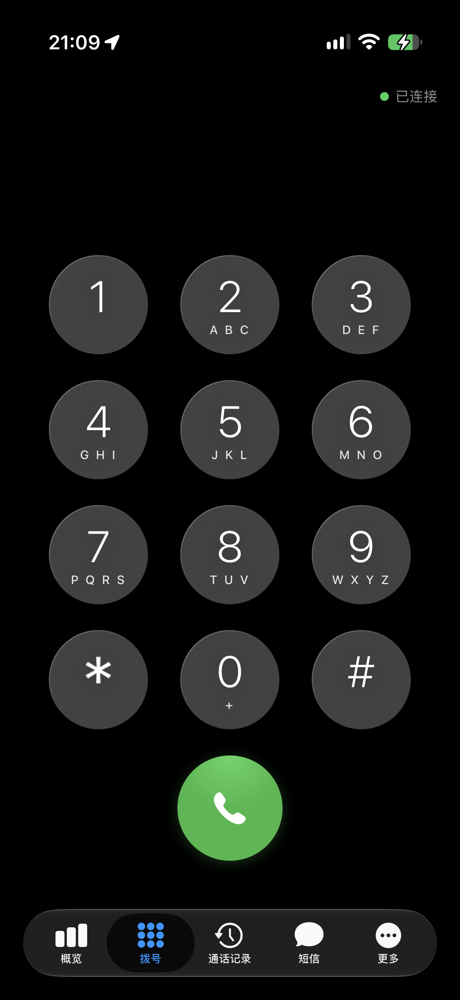
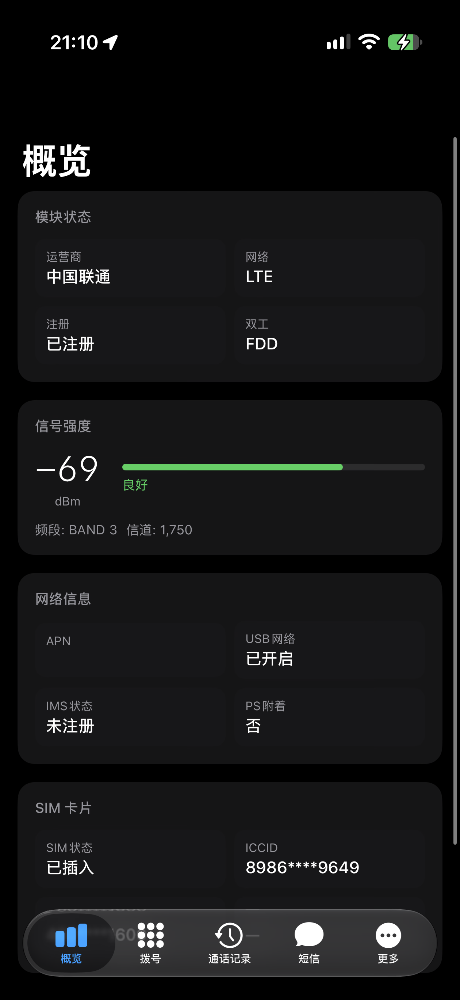
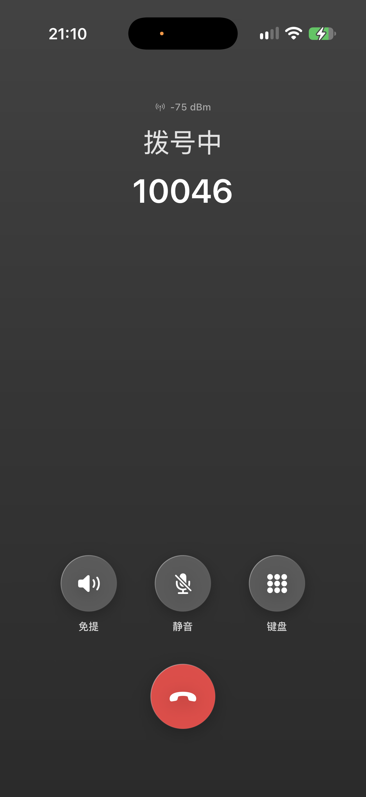
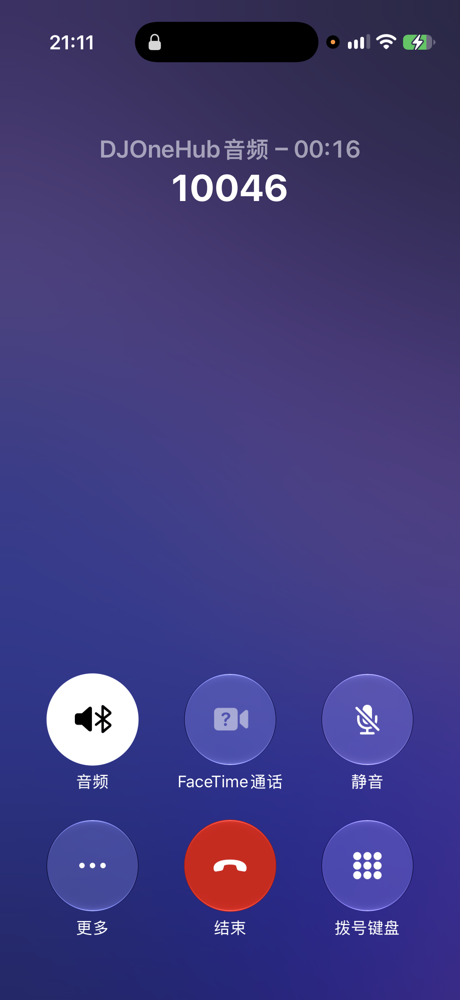
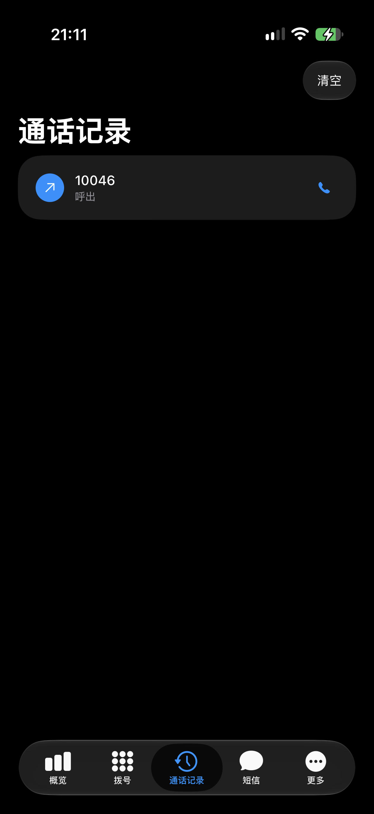
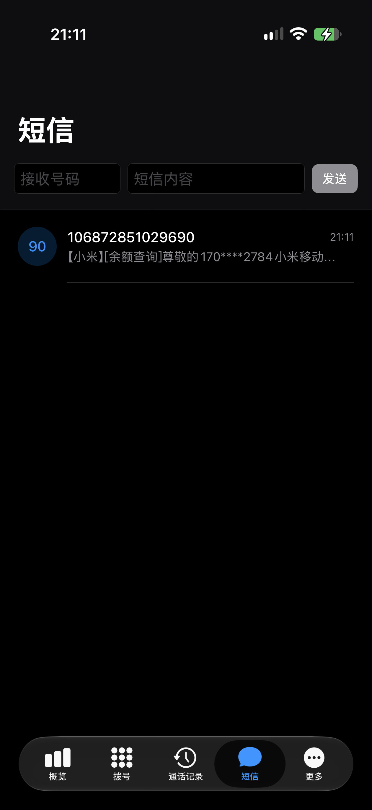
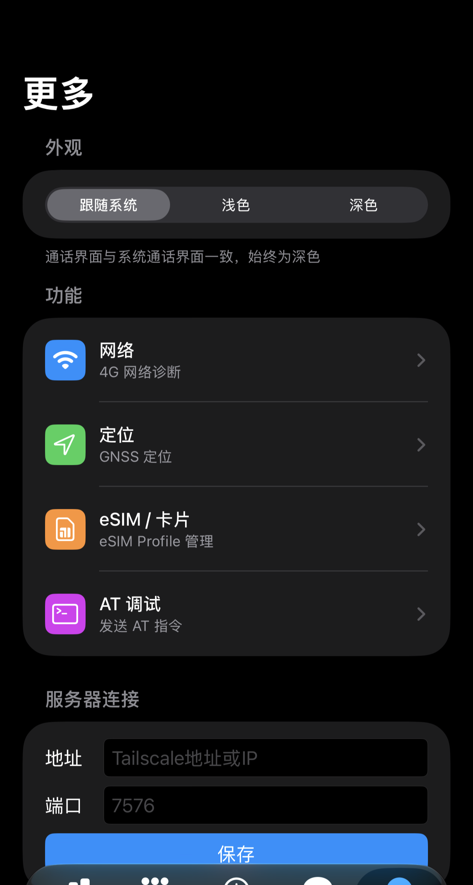

# DJOneHub with iOS

## 项目目的

**有锁版（运营商锁）iPhone** 与**纯 eSIM 版（无实体卡槽）iPhone** 通常无法直接使用三大运营商实体 SIM 卡。本项目让这类设备**保持 Apple Intelligence 与国内生态的完整体验**，同时通过三大运营商 SIM 卡正常拨打电话、收发短信。

实现方式：将三大运营商 SIM 卡（实体卡或 eSIM 均可）装入 4G USB 模块（BAIWANG / QDC 系列），模块通过 USB 连接 Mac 作为"随身基站"；iPhone 经局域网或 Tailscale 远程接入，通话与短信由这条链路完成——**不依赖运营商锁、不占用实体卡槽**，锁屏也能以 CallKit 原生界面接听来电。

```
┌────────────┐  WebSocket   ┌────────────────┐   HTTP    ┌────────────────┐   USB   ┌────────────┐
│ iPhone App │ ◄──────────► │ djonehub-remote│ ◄───────► │ djonehub-macos │ ◄─────► │  4G 模块   │
│  (CallKit) │    7576      │  Go 代理        │   7575   │  主服务        │         │ (BAIWANG)  │
└────────────┘              └────────────────┘           └────────────────┘         └────────────┘
                                     ▲                          │
                                     │ Unix socket              │ UAC / USB
                                     ▼                          ▼
                              ┌────────────────┐        ┌────────────────┐
                              │ DJOneHubNotifier│       │  Mac 音频桥     │
                              └────────────────┘        └────────────────┘
```

- **iPhone App**（`ios/`）：拨号盘、通话记录、短信、CallKit 系统通话界面；通话中全屏覆盖层、深灰渐变背景、Liquid Glass 风格按键、三档主题（浅色/深色/跟随系统）、20ms 节奏音频收发与自适应抖动缓冲。
- **Go 代理**（`proxy/`）：iPhone 与主服务之间的 WebSocket 信令/音频转发。
- **主服务**（`server/`）：AT 指令控制 4G 模块（拨号/接听/挂断/DTMF/短信/eSIM/信号查询）。
- **Mac 音频桥**（`server/macos/`）：模块 UAC 语音通道桥接。上行完全来自 iPhone 麦克风（不采集 Mac 音频），静音全链路生效。

## 功能特性

- 双向通话（呼出/来电），CallKit 锁屏来电与系统通话界面
- 通话中：静音、免提、DTMF 键盘、联系人头像、信号强度、通话时长
- 通话记录（滑动删除 / 一键清空，三端联动）
- 短信收发、验证码识别、未读角标
- 拨号盘 0 键长按输入 `+`、按键音、Liquid Glass 视觉
- 浅色 / 深色 / 跟随系统 三档主题
- 断线自动重连与状态提示

## 界面预览

| 拨号盘 | 模块概览与信号 | 通话中 |
| --- | --- | --- |
|  |  |  |

| CallKit 系统通话界面 | 通话记录 | 短信 |
| --- | --- | --- |
|  |  |  |

| 设置 |
| --- |
|  |

> 通话界面与 iOS 系统通话界面一致：深灰渐变背景、Liquid Glass 玻璃按键，锁屏由 CallKit 接管。

## 寻求帮助

项目目前**缺少后台 CallKit 来电推送（VoIP Push）能力**：App 在前台或锁屏时可正常接听来电，但进程被系统挂起后无法收到新来电通知。补全这一能力需要：

- 申请 VoIP Push Certificate（APNs）
- 部署推送服务（见 `proxy/push_relay.go`）
- **发布到 Apple App Store**（正式发布才能稳定获得后台推送的合规通道）

**诚挚希望有经验的大神协助完成 App Store 发布**，让项目补全后台 CallKit 推送闭环。欢迎通过 Issue / PR 联系，也欢迎 fork 与二次开发。

## 快速开始

### 依赖

- macOS（主服务与音频桥）
- Go 1.24+
- Xcode 16+（iOS 端，目标 iOS 16+）
- XcodeGen（iOS 工程由 `project.yml` 生成）

### 1. 构建主服务

```bash
cd server
go build -o djonehub-macos ./cmd/djonehub-macos
./djonehub-macos -listen 127.0.0.1:7575
```

### 2. 构建代理

```bash
cd proxy
go build -o djonehub-remote .
./djonehub-remote   # 监听 0.0.0.0:7576
```

### 3. 构建 Mac 音频桥（DJOneHubNotifier）

```bash
cd server/macos/DJOneHubNotifier
./build-app.sh      # 产物：dist/DJOneHubNotifier.app
```

### 4. 构建 iOS App

```bash
cd ios
xcodegen generate
xcodebuild -project DJOneHub.xcodeproj -scheme DJOneHub -destination "id=YOUR_DEVICE_UDID" build
```

安装后在 App「更多」页填写服务器地址（代理 IP:7576，支持局域网或 Tailscale 组网）。

## 参考项目

本项目在开发过程中参考、借鉴或集成了以下开源项目，在此致谢：

| 项目 | 地址 | 说明 |
| --- | --- | --- |
| DJOneHub（主分支） | https://github.com/ZenGeekLabs/DJOneHub | 主分支，无通话能力，支持短信/eSIM/上网/AT 调试 |
| DJOneHub mac-enhanced（增强版） | https://github.com/rogerbush007-a11y/DJOneHub-mac-enhanced | 增强版 v1.2.9，支持双向通话，本项目 `server/` 基于它 |
| MaVo | https://github.com/moluncn/mavo | macOS 原生菜单栏蜂窝助手，Swift 编写，支持通话/短信/上网 |
| VoCat | https://github.com/MengMengCode/VoCat | VoHive 停更后的替代，完全开源，Go+React+SQLite |
| dji-4g-vohive-mac | https://github.com/wlzh/dji-4g-vohive-mac | 经典 VoHive 虚拟机方案（Mac 用户备选） |
| DJOneHubNative | https://github.com/ZenGeekLabs/DJOneHubNative | 包含 QDC507 硬件研究资料（MODULE_RESEARCH.md） |

## 许可证

本项目采用分层许可证：

- `server/` 继承上游 [PolyForm Noncommercial License 1.0.0](server/LICENSE)（仅允许非商业用途），并保留上游第三方组件声明（见 `server/THIRD_PARTY_NOTICES.md`）。
- `proxy/` 与 `ios/` 为原创部分，采用 [MIT License](LICENSE)。

完整第三方声明见各子目录 LICENSE 与 NOTICES 文件。
